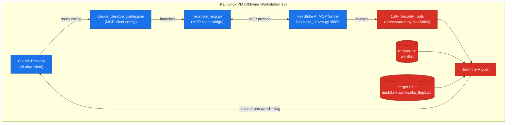

# AI-Assisted Cybersecurity Lab: HexStrike AI MCP + Claude Desktop + John the Ripper


A two-module practical lab demonstrating an **AI-assisted penetration testing workflow**: connecting an AI chat client (Claude Desktop) to offensive-security tooling through the **Model Context Protocol (MCP)**, using the **HexStrike AI MCP server** as the bridge, and then driving a real tool — **John the Ripper** — through that bridge to recover the password on an authorized lab PDF.

This repository is a personal lab writeup for the **NetworkWalks Cybersecurity Program (Batch B084J)**, documenting work performed on my own Kali Linux VM.

---

<details>
<summary><strong>📌 Documentation notes & assumptions (click to expand)</strong></summary>

This README was generated from the lab brief, confirmed AI prompts, and the author's own screenshot filenames/timestamps. A few things are flagged here rather than silently guessed, per the project's own documentation standard:

- **Screenshot ordering:** Screenshots are placed in the order their filenames' timestamps suggest (chronological capture order), not from having viewed each image's contents. Captions describe the *expected* step at that point in the workflow — verify each image against its caption before publishing, and adjust/reorder if needed.
- **Tool versions:** Exact HexStrike AI build number, Claude Desktop version, and JTR version actually shown in the screenshots are not independently confirmed here — the install commands below reflect the two referenced repositories' current public documentation. Replace with the literal version strings from your terminal output where they differ.
- **Claude Desktop packaging:** The `aaddrick/claude-desktop-debian` project has changed its package name over time (now ships as `claude-desktop-unofficial` alongside Anthropic's own official APT repo on some branches). Use whichever command matches what your screenshots actually show.
- **Flags:** Two flags are included below (`flag1` and the `persistence` flag) because their identifiers match this lab session. Two additional candidate strings supplied during drafting used a different naming/date pattern and were left out as likely belonging to a different lab — confirm before adding them here.

</details>

---

## Table of Contents

1. [Project Overview](#project-overview)
2. [Objectives](#objectives)
3. [Learning Outcomes](#learning-outcomes)
4. [Lab Environment](#lab-environment)
5. [Tools and Technologies](#tools-and-technologies)
6. [Architecture](#architecture)
7. [Repository Structure](#repository-structure)
8. [Module 01 — HexStrike AI MCP Server Setup with Claude Desktop](#module-01--hexstrike-ai-mcp-server-setup-with-claude-desktop)
9. [Module 02 — AI-Assisted PDF Password Recovery with John the Ripper](#module-02--ai-assisted-pdf-password-recovery-with-john-the-ripper)
10. [Hashing vs. Password-Hash Extraction](#hashing-vs-password-hash-extraction)
11. [Results and Lab Completion](#results-and-lab-completion)
12. [Troubleshooting & Observations](#troubleshooting--observations)
13. [Security and Ethical Considerations](#security-and-ethical-considerations)
14. [References](#references)
15. [Credits](#credits)
16. [Author](#author)

---

## Project Overview

Most penetration-testing tool usage is still manual: the operator runs a tool, reads the output, and decides the next command. This lab explores the alternative — letting an AI chat client **drive** real security tools through a standardized protocol, while the human operator stays in control of what's authorized and what's executed.

The project is split into two connected modules:

| Module | Focus |
|---|---|
| **Module 01** | Stand up the AI ↔ tooling bridge: install Claude Desktop on Kali, deploy the HexStrike AI MCP server, and connect them via MCP configuration. |
| **Module 02** | Use that bridge for a real task: identify, hash, and recover the password of an authorized lab PDF using John the Ripper and the rockyou wordlist — driven entirely through natural-language prompts to Claude Desktop. |

## Objectives

- Stand up a working **MCP integration** between an AI chat client and a cybersecurity automation server.
- Understand how an AI agent selects and invokes command-line security tools through MCP rather than an operator typing them directly.
- Perform an authorized password-recovery exercise against a lab-provided PDF.
- Document the difference between a general file-integrity hash and a password/credential hash suitable for offline cracking.
- Produce a reproducible, evidence-backed writeup suitable for a cybersecurity learning portfolio.

## Learning Outcomes

- Practical experience configuring **Model Context Protocol (MCP)** servers and clients.
- Hands-on exposure to **HexStrike AI**, an MCP-based offensive-security automation framework.
- Reinforced understanding of **John the Ripper** workflows: hash extraction, wordlist attacks, and result verification.
- Awareness of the operational and ethical guardrails needed when AI agents are given access to security tooling.

## Lab Environment

| Component | Detail |
|---|---|
| Host OS | Windows 11 |
| Virtualization | VMware Workstation 17 Player |
| Guest OS (lab VM) | Kali Linux |
| AI Client | Claude Desktop |
| Integration | Model Context Protocol (MCP) |

## Tools and Technologies

| Category | Tool / Technology |
|---|---|
| Operating System | Kali Linux (VMware VM) |
| AI Client | Claude Desktop |
| Integration Layer | Model Context Protocol (MCP) |
| Security Automation Server | [HexStrike AI MCP](https://github.com/0x4m4/hexstrike-ai) |
| Password Recovery | John the Ripper (JTR) |
| Wordlist | `rockyou.txt` |
| Target Artifact | Authorized, password-protected lab PDF |
| Version Control | Git / GitHub |

## Architecture



**Module 01** (blue) establishes the environment and the AI↔tool integration. **Module 02** (red) demonstrates practical tool interaction — the PDF recovery task — running through that already-configured bridge.

## Repository Structure

> Proposed structure, shown for navigation. Match this to your actual folder layout before committing — screenshot filenames below are kept exactly as captured.

```text
NETWORKWALKS-B084J-WK3-HexStrike-MCP-Claude-Lab/
│
├── README.md
│
├── Module-01-HexStrike-MCP-Claude/
│   └── screenshots/
│       ├── Screenshot 2026-11-16 031657.png
│       ├── Screenshot 2026-11-16 031717.png
│       ├── ... (18 screenshots total)
│
├── Module-02-JTR-PDF-Password-Recovery/
│   └── screenshots/
│       ├── Screenshot 2026-11-18 052242.png
│       ├── Screenshot 2026-11-18 052406.png
│       ├── ... (8 screenshots total)
│
└── docs/
    └── lab-manuals/   (original NetworkWalks lab PDFs, optional)
```

---

## Module 01 — HexStrike AI MCP Server Setup with Claude Desktop

### Objective
Install Claude Desktop on Kali Linux, deploy the HexStrike AI MCP server, and connect the two so Claude Desktop can invoke HexStrike's tools through MCP.

### Environment
Kali Linux VM (VMware Workstation 17 Player), Python 3, internet access for package/repo downloads.

### Prerequisites
- A working Kali Linux installation with a desktop environment.
- `git`, `python3`, `python3-venv`, and `pip3` available.
- Outbound internet access for `apt`, `git clone`, and `pip install`.

### Tools Used
Claude Desktop (via the `aaddrick/claude-desktop-debian` community packaging project) and the HexStrike AI MCP server.

> Claude Desktop's official distribution is published by Anthropic; `aaddrick/claude-desktop-debian` is an independent, community-maintained packaging project that repackages it for Debian-based Linux distributions such as Kali. It is **not** an official Anthropic package.

### Installation and Configuration

**Step 1 — Install Claude Desktop (Debian/Kali via APT repo)**

```bash
# Add the project's signing key
curl -fsSL https://aaddrick.github.io/claude-desktop-debian/KEY.gpg | sudo gpg --dearmor -o /usr/share/keyrings/claude-desktop.gpg

# Add the APT source
echo "deb [signed-by=/usr/share/keyrings/claude-desktop.gpg arch=amd64,arm64] https://aaddrick.github.io/claude-desktop-debian stable main" | sudo tee /etc/apt/sources.list.d/claude-desktop.list

# Install
sudo apt update
sudo apt install claude-desktop
```

> ⚠️ Depending on when the lab was performed, this project ships the package as `claude-desktop` or `claude-desktop-unofficial`. Use whichever name your own terminal output/screenshots show.

**Step 2 — Clone and set up HexStrike AI**

```bash
git clone https://github.com/0x4m4/hexstrike-ai.git
cd hexstrike-ai

# Create and activate a virtual environment
python3 -m venv hexstrike-env
source hexstrike-env/bin/activate

# Install dependencies
pip3 install -r requirements.txt
```

**Step 3 — Start the HexStrike AI MCP server**

```bash
# Start the server (default port 8888)
python3 hexstrike_server.py

# Optional: debug mode
python3 hexstrike_server.py --debug

# Optional: custom port
python3 hexstrike_server.py --port 8888
```

**Step 4 — Verify the server is running**

```bash
curl http://localhost:8888/health
```

**Step 5 — Configure Claude Desktop to use the HexStrike MCP server**

Edit (or create) `~/.config/Claude/claude_desktop_config.json`:

```json
{
  "mcpServers": {
    "hexstrike-ai": {
      "command": "python3",
      "args": [
        "/home/kali/hexstrike-ai/hexstrike_mcp.py",
        "--server",
        "http://localhost:8888"
      ],
      "description": "HexStrike AI v6.0 - Advanced Cybersecurity Automation Platform",
      "timeout": 300,
      "disabled": false
    }
  }
}
```

> **Note:** `/home/kali/hexstrike-ai/...` is an example path. Replace it with wherever you actually cloned the repository on your own machine — this is not a fixed install location.

**Step 6 — Restart Claude Desktop** so it picks up the new MCP server, then open a chat and confirm HexStrike's tools are available to it.

### Screenshot Evidence — Module 01

*(Ordered by capture timestamp; verify each caption against the actual image before publishing.)*

| # | Screenshot | Expected content |
|---|---|---|
| 1 | `Screenshot 2026-11-16 031657.png` | Lab start / desktop environment |
| 2 | `Screenshot 2026-11-16 031717.png` | HexStrike AI banner / repo clone |
| 3 | `Screenshot 2026-11-16 031740.png` | Python virtual environment creation |
| 4 | `Screenshot 2026-11-16 032516.png` | Dependency installation (`pip3 install -r requirements.txt`) |
| 5 | `Screenshot 2026-11-16 032539.png` | HexStrike server startup |
| 6 | `Screenshot 2026-11-16 032607.png` | Server health check / console output |
| 7 | `Screenshot 2026-11-16 032719.png` | Claude Desktop installation |
| 8 | `Screenshot 2026-11-16 032830.png` | Claude Desktop launched |
| 9 | `Screenshot 2026-11-16 032907.png` | MCP config file (`claude_desktop_config.json`) being edited |
| 10 | `Screenshot 2026-11-16 033436.png` | MCP config saved / Claude Desktop restarted |
| 11 | `Screenshot 2026-11-16 033450.png` | Claude Desktop recognizing the HexStrike MCP server |
| 12 | `Screenshot 2026-11-16 033636.png` | Verification prompt/response in Claude Desktop |
| 13 | `Screenshot 2026-11-16 033925.png` | Tool list / capability confirmation |
| 14 | `Screenshot 2026-11-16 034635.png` | Additional configuration/verification |
| 15 | `Screenshot 2026-11-16 034653.png` | Additional configuration/verification |
| 16 | `Screenshot 2026-11-16 034854.png` | Additional configuration/verification |
| 17 | `Screenshot 2026-11-16 042142.png` | Final environment check |
| 18 | `Screenshot 2026-11-16 044157.png` | Module 01 completion |

```markdown

```

### Observations
Setting up the MCP bridge is primarily a one-time configuration task (path correctness in the JSON config is the most common failure point). Once connected, HexStrike's tool catalog becomes available to Claude Desktop as callable MCP tools rather than shell commands the operator types manually.

### Result
Claude Desktop successfully connected to the HexStrike AI MCP server, confirming the environment was ready for Module 02's practical task.

---

## Module 02 — AI-Assisted PDF Password Recovery with John the Ripper

### Objective
Use the MCP-connected environment from Module 01 to recover the password on an authorized, lab-provided PDF, driving John the Ripper entirely through natural-language prompts to Claude Desktop.

### Environment
Same Kali Linux VM, with the HexStrike AI MCP server running and Claude Desktop connected (per Module 01).

### Prerequisites
- Module 01 completed and the MCP connection confirmed working.
- John the Ripper installed (ships by default on Kali Linux).
- `rockyou.txt` wordlist available (commonly pre-installed, often compressed, under `/usr/share/wordlists/`).
- The target lab PDF placed on the Kali Desktop (per the lab manual).

### Workflow

**Step 1 — Lab file preparation**
The supplied lab PDF was placed on the Kali Linux Desktop at `/home/kali/Desktop/hash3.networkwalks_flag1.pdf`.

**Step 2 — Verify John the Ripper is available**
Rather than running `john --version` manually, the check was requested through Claude Desktop via the HexStrike MCP connection.

**Step 3 — Calculate the file hash**
A hash of the target PDF was requested — useful for file identification/integrity, and distinct from the password hash used for cracking (see [Hashing vs. Password-Hash Extraction](#hashing-vs-password-hash-extraction)).

**Step 4 — Password recovery workflow**
John the Ripper was invoked through the HexStrike MCP integration against the PDF's extracted password hash, using the `rockyou.txt` wordlist.

**Step 5 — Verify the recovered result**
The recovered password was used to confirm the PDF opened successfully, verifying the crack was correct.

**Step 6 — Lab flag**
The flag contained in the lab PDF was retrieved upon successful access (see [Results and Lab Completion](#results-and-lab-completion)).

### AI Prompts Used

> **Tool verification prompt:**
> Check if John the Ripper is installed in this HexStrike MCP and show me its version.

> **File hashing prompt:**
> Please calculate the hash value of this PDF file: `/home/kali/Desktop/hash3.networkwalks_flag1.pdf`

> **Password recovery prompt:**
> Please use the JTR tool in this HexStrike MCP server to crack the password of this PDF file. Use the rockyou.txt wordlist dictionary.

### Screenshot Evidence — Module 02

*(Ordered by capture timestamp; verify each caption against the actual image before publishing.)*

| # | Screenshot | Expected content |
|---|---|---|
| 1 | `Screenshot 2026-11-18 052242.png` | Lab PDF placed on Desktop |
| 2 | `Screenshot 2026-11-18 052406.png` | JTR installation/version check prompt and response |
| 3 | `Screenshot 2026-11-18 052700.png` | Hash calculation prompt and response |
| 4 | `Screenshot 2026-11-18 053031.png` | Password-recovery prompt issued |
| 5 | `Screenshot 2026-11-18 053104.png` | JTR running against the PDF via HexStrike MCP |
| 6 | `Screenshot 2026-11-18 053247.png` | JTR cracking progress / rockyou.txt in use |
| 7 | `Screenshot 2026-11-18 053436.png` | Recovered password returned by Claude Desktop |
| 8 | `Screenshot 2026-11-18 053517.png` | PDF opened with recovered password / flag visible |

```markdown

```

### Result
The PDF's password was successfully recovered via JTR + rockyou.txt, driven entirely through AI prompts to Claude Desktop over the HexStrike MCP connection, and the recovery was confirmed by reopening the file.

---

## Hashing vs. Password-Hash Extraction

Two different kinds of "hash" come up in this lab, and they serve different purposes:

- **File-identification hash** (e.g., SHA-256/MD5 of the whole PDF file): a checksum used to verify a file hasn't changed or to uniquely identify a specific file. It says nothing about the file's password.
- **Password/credential hash**: a value derived from the PDF's own encryption metadata (its security handler), which represents the password in a form that can be tested offline. Tools like John the Ripper don't attack the PDF directly — they attack this extracted hash, trying candidate passwords (from a wordlist like `rockyou.txt`) until one produces a match.

This is why "hashing the file" (Step 3) and "cracking the password" (Step 4) are two separate actions in the workflow above, not the same step.

## Results and Lab Completion

**Module 01:** MCP bridge between Claude Desktop and the HexStrike AI MCP server established and verified.

**Module 02:** PDF password successfully recovered via John the Ripper (rockyou.txt wordlist) through the HexStrike MCP integration, confirmed by reopening the recovered PDF.

**Flags captured:**

```text
nw{networkwalks_flag1_jtr_270521_1}
nw{networkwalks_persistence_jtr_270521}
```

**Demo videos (LinkedIn):**
- [Part 1](https://www.linkedin.com/feed/update/urn:li:ugcPost:7528622429221318656/)
- [Part 2](https://www.linkedin.com/feed/update/urn:li:activity:7528624443938529280/)

## Troubleshooting & Observations

- The most common failure point in Module 01 is an incorrect absolute path in `claude_desktop_config.json` — the MCP server won't be picked up if the path to `hexstrike_mcp.py` doesn't match the actual clone location.
- Claude Desktop must be fully restarted (not just the chat window closed) after editing the MCP config for changes to take effect.
- Large wordlists like `rockyou.txt` are sometimes shipped compressed (`rockyou.txt.gz`) on Kali and need to be extracted before use.

## Security and Ethical Considerations

This project was carried out in a controlled, educational lab environment as part of the NetworkWalks Cybersecurity Program. All tooling was used only against lab-provided or self-owned files — specifically the password-protected PDF supplied for this exercise.

- Tools demonstrated here (HexStrike AI, John the Ripper) must only be used against systems, files, or accounts for which you have **explicit authorization**.
- Password recovery should only be performed on authorized lab files, your own files, or files for which recovery has been explicitly permitted by the owner.
- AI-assisted execution of security tooling should always be reviewed and controlled by a human operator — the AI selects and invokes tools, but the operator is accountable for what gets run.
- This repository does not authorize, condone, or provide a basis for unauthorized access, credential theft, or attacks against third-party systems.

## References

- HexStrike AI: [https://github.com/0x4m4/hexstrike-ai](https://github.com/0x4m4/hexstrike-ai)
- Claude Desktop (Debian/Linux packaging): [https://github.com/aaddrick/claude-desktop-debian](https://github.com/aaddrick/claude-desktop-debian)

## Credits

Lab exercises and training material for this project are based on coursework from **NetworkWalks Academy** (Batch B084J). The implementation, configuration, documentation, and screenshots in this repository are the author's own practical work completed as part of that training — the original training content itself was not authored by the repository owner.

## Author

**Rajatava Ghosh**
Cybersecurity student — NetworkWalks Cybersecurity Program (Batch B084J)

- GitHub: [RaxingR](https://github.com/RaxingR) (this lab repository is hosted under [Hypo46](https://github.com/Hypo46))
- LinkedIn: [rajatava-ghosh](https://www.linkedin.com/in/rajatava-ghosh-265aa6316/)
